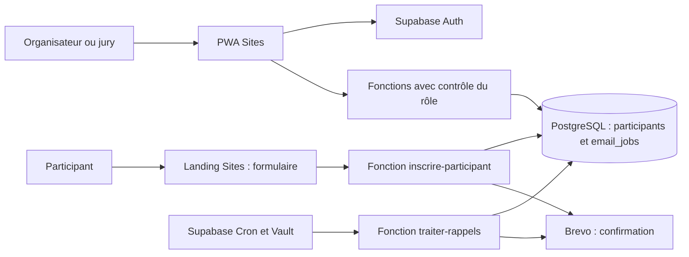

# Architecture actuelle de la démonstration hébergée

Le prototype actif utilise HTML/CSS/JavaScript statiques sur Sites, Supabase pour Auth/PostgreSQL/fonctions et Cron, et Brevo uniquement côté serveur. Aucun Make. Les fichiers du prototype Node/SQLite sont archivés dans prototype-local ; l’ancienne architecture Vercel ne décrit pas le déploiement actif.

L’accès propriétaire Sites protège la démonstration hébergée ; il est distinct de l’authentification métier Supabase. Les points d’entrée Supabase vérifient eux-mêmes leur autorisation. L’inscription ne requiert pas de compte participant. Les fonctions d’équipe vérifient le jeton auprès de Supabase Auth puis le rôle dans team_users. Le planificateur utilise un secret technique distinct, conservé dans les secrets de fonctions et Vault.

| Rôle | Données et actions |
| --- | --- |
| Participant | Formulaire public d’inscription ; aucune consultation interne |
| Jury | Participants actifs sans adresses ; saisie/modification des notes ; classement interne |
| Organisateur | Participants actifs/retirés, coordonnées, retrait/réactivation, notes en lecture seule, classement et historique des e-mails |
| Planificateur | Réservation/traitement des rappels dus ; aucune interface ni identité jury |

## Données et règles

participants contient l’identité minimale, l’e-mail normalisé unique et le statut. team_users relie le compte Auth à un rôle. scores contient un jeu de trois notes par participant et l’identité jury vérifiée serveur. email_jobs contient une confirmation et un rappel par participant, contenu/destinataire/échéance/état/identifiant fournisseur. Les tables métier ont RLS et refusent l’accès direct anon/authenticated ; les fonctions utilisent service_role côté serveur. L’exécution directe de la matrice RLS dans l’environnement hébergé reste une vérification distincte.

register_participant crée atomiquement le participant et ses deux tâches. La confirmation est tentée après cet enregistrement. Le rappel est réclamé à échéance avec l’horloge PostgreSQL et SKIP LOCKED, deux maximum par invocation Cron chaque minute. Les adresses réservées sont simulées, les participations retirées exclues et les rappels après l’événement ignorés. Une erreur ou une réponse incertaine ne déclenche pas de renvoi automatique ; vérifier les états processing/uncertain et le journal fournisseur avant reprise.

Le classement est calculé dans la PWA à partir des données autorisées : actifs avec trois notes complètes, somme décroissante sur 30, égalités 1/1/3. Les fonctions vérifient le barème et refusent la notation d’un retiré, même si un dialogue ancien est ouvert.

## Session et cache

sessionStorage conserve uniquement le jeton temporaire de l’onglet et son échéance absolue, une heure maximum. Aucun mot de passe ou refresh token, aucun rôle ou participant persistant. Le rôle est rechargé côté serveur avant affichage après actualisation. sessionStorage est accessible au JavaScript de l’origine ; il ne s’agit pas d’un cookie HttpOnly. Déconnexion/expiration/refus d’accès effacent ce stockage. Le service worker ne cache que la coquille statique, jamais les API, jetons ou données métier. Une connexion Internet est nécessaire.

Les fonctions sont déployées manuellement dans Supabase ; la publication Sites déploie uniquement dist. GitHub origin est la source privée de référence, sites le dépôt de publication. Les secrets, bases et exports métier restent hors Git. Lire DEPLOYMENT.md avant de modifier une configuration et ne jamais appliquer le schéma initial en bloc à la base existante.
