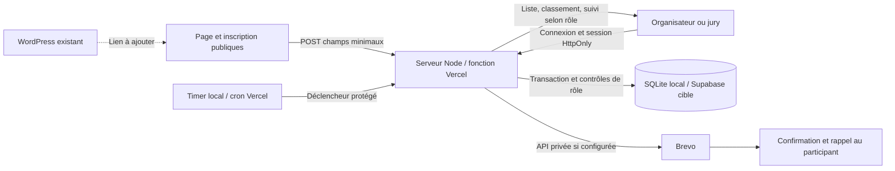
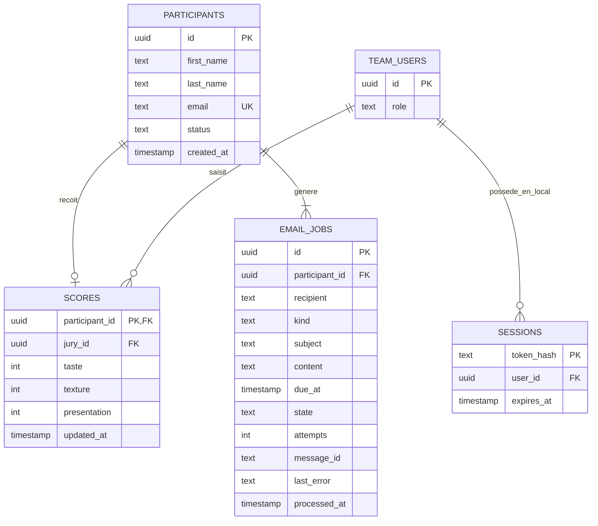
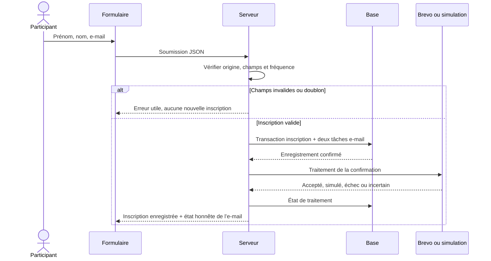

# Architecture minimale

> État de l’architecture : les sections historiques ci-dessous décrivent le prototype Node/SQLite et ses adaptateurs. L’application hébergée actuelle est statique (dist) avec Supabase Auth, fonctions serveur et Cron. À la demande utilisateur, son jeton d’accès temporaire est désormais conservé dans sessionStorage de l’onglet, sous échéance absolue d’une heure maximum, puis revérifié par le serveur après actualisation. Elle n’utilise pas le cookie HttpOnly décrit pour le prototype. Voir architecture-hebergee.md, D24, DEPLOYMENT.md et README.md pour l’état courant.

## Choix

Un serveur **Node.js 24**, HTML/CSS/JavaScript sans compilation. Aucun paquet npm nécessaire. Cela permet d’exécuter et de tester l’ensemble sans comptes externes. Le stockage est un choix explicite `DATA_BACKEND` ; aucun basculement silencieux en cas de panne.

| Composant | Local, opérationnel | Cible externe, préparée |
| --- | --- | --- |
| Page et espace équipe | Fichiers public/ servis par Node | Même interface servie par la fonction Vercel |
| Serveur | src/server.mjs | api/index.mjs, configuration vercel.json |
| Base | SQLite sur disque, transactions et contraintes | Supabase PostgreSQL, RPC transactionnelles, RLS |
| Authentification | Mots de passe scrypt, session opaque 1 h hachée en base | Supabase Auth, jeton en cookie HttpOnly 1 h, identité revérifiée à chaque requête |
| Autorisation | Vérification du rôle côté serveur | Même vérification, rôle team_users chargé côté serveur |
| E-mails | Contenu en base et traitement simulé | API transactionnelle Brevo côté serveur |
| Rappel | Timer Node toutes les 30 s, processus actif requis | Appel cron authentifié chaque minute, forfait Vercel compatible nécessaire |

La proposition Vercel/Supabase/Brevo est conservée comme cible ; l’exécution SQLite est une variante de démonstration ajoutée pour éviter une maquette sans persistance. GitHub est une destination possible du code, aucun dépôt distant n’est créé.

## Modèle de données

Unicités : e-mail participant normalisé ; participant + type d’e-mail ; un jeu complet de notes par participant. Les trois critères fixes sont des colonnes, décision adaptée au barème fixe et à l’unique compte jury de cette V1. Une évolution multi-jurés/critères configurables exigera une migration dédiée. Total et rang ne sont pas stockés, ils sont recalculés. En local team_users contient aussi e-mail et hash scrypt ; en externe ces données d’authentification sont gérées par Supabase Auth.

## Séquence d’inscription

## File e-mail et rappels

`pending → processing → simulated / accepted / failed / uncertain`. `skipped` décrit un rappel tardif, expiré ou annulé par retrait. Un lot réclame atomiquement au plus deux messages dus. Le rappel est éligible à événement −24 h ; si le processus a été arrêté jusqu’après l’événement, il est ignoré.

Deux traitements concurrents ne réclament pas le même message : transaction SQLite ou verrou `FOR UPDATE SKIP LOCKED` PostgreSQL. Un statut `processing` après interruption du processus doit être vérifié dans Brevo avant intervention ; aucune garantie « exactement une fois » n’est annoncée pour un appel réseau. Pas de reprise automatique d’un résultat incertain. Un échec fournisseur traité ne bloque pas les autres messages. En cas de panne de la base pendant l’enregistrement du résultat, une tâche peut rester `processing` : contrôle manuel requis.

Le cron traite au plus deux messages par minute ; un volume plus important peut retarder les rappels. Le timer local n’est actif que pendant l’exécution de Node. La précision « à J−1 » est donc une échéance cible, pas une garantie à la seconde.

## Accès

| Action | Public | Organisateur | Jury |
| --- | --- | --- | --- |
| Page / inscription | Oui | Oui | Oui |
| Liste des inscrits | Non | Avec e-mail | Sans e-mail |
| Modifier le statut | Non | Oui | Non |
| Saisir les notes | Non | Non | Oui |
| Classement | Non | Oui | Oui |
| États et contenus d’e-mails | Non | Oui | Non |

Les droits sont contrôlés dans les routes et ne reposent pas sur les boutons visibles. Supabase refuse l’accès direct aux tables et aux RPC pour `anon` et `authenticated` ; la clé privilégiée est limitée au serveur, qui vérifie le rôle avant tout accès métier. Le compte visiteur n’obtient jamais de données internes via l’API publique.

Session HttpOnly, SameSite=Strict, Secure sous HTTPS, durée 1 h. Origine vérifiée pour les mutations ; cookie jamais en localStorage. Pas de CORS ouvert. Validation serveur et client, taille de corps limitée, limite de fréquence en mémoire. Cette limite est locale à une instance et n’est pas une protection distribuée ; ajouter une protection adaptée avant exposition publique.

## Statut de déploiement

Rien n’est publié et aucune ressource externe n’est créée. Les outils de publication Sites n’ont pas leurs scripts locaux nécessaires dans cet environnement ; les comptes Vercel/Supabase/Brevo ne sont pas configurés. Les intégrations sont préparées et leurs vérifications restent explicitement à faire. SQLite est interdit par configuration sur Vercel, où le disque local ne constitue pas une base persistante.
